# mcp-gate

[](https://github.com/vsem-azamat/mcp-gate/actions/workflows/ci.yml)
[](https://github.com/vsem-azamat/mcp-gate/releases)
[](go.mod)
[](LICENSE)

mcp-gate sits between your AI agents and your [MCP](https://modelcontextprotocol.io) servers. Each server gets its own URL, each agent gets its own token, and passwords or API keys in a server's answer are hidden before the agent sees them.

It is one Go binary, built on the official [MCP Go SDK](https://github.com/modelcontextprotocol/go-sdk).

<picture>
  <source media="(prefers-color-scheme: dark)" srcset=".github/assets/request-path-dark.svg">
  
</picture>

## Why I wrote it

I run about a dozen MCP servers for my own agents. I wanted secrets hidden from the model, a way to read a hidden value myself, a name on every token so the log shows who called what, OAuth that works with real providers, and new protocol versions soon after they come out. The open-source gateways I tried each had some of this, none had all of it. I patched one of them for a while, but my pull requests there waited a long time for review. So I wrote my own.

## Features

- **A URL per server.** Local (stdio) and remote (Streamable HTTP) servers are served at `/<server>/mcp`. The gate starts local servers, checks that they respond and restarts them when they crash. While a server restarts, agents can still list its tools.
- **A token per agent.** Each token has a name, and the log line for every call says which token made it. A token can work for all servers or for one. A server can also be open without a token.
- **Allow and deny lists** for tools, prompts and resources, set per server.
- **Hidden secrets.** API keys, private keys, `Authorization` headers, `.env` lines and passwords in URLs are replaced with `[REDACTED:<kind>]` in answers, in error messages and in server logs. If the gate cannot check an answer, the agent gets an error instead of the answer. Files that a tool downloads are checked too, and the agent does not get the path to a file with secrets in it.
- **Secret vault (optional).** With an owner key set, hidden values are kept in memory for a day, and you can read them with that key. Agent tokens cannot.
- **OAuth for remote servers.** `mcp-gate auth login` signs in once in any browser. The gate stores the grant and refreshes it.
- **Protocol versions.** The gate remembers which protocol version each server speaks. You can also set it in the config.
- **For running it.** Health endpoints, a `/_status` page for admins, JSON logs that never contain arguments or answers, and systemd units.
- **For moving over.** `import` converts a [TBXark/mcp-proxy](https://github.com/TBXark/mcp-proxy) config, and `compare` shows what differs between two gateways.

## How it compares

| | **mcp-gate** | [mcp-proxy](https://github.com/TBXark/mcp-proxy) | [Docker](https://github.com/docker/mcp-gateway) | [ContextForge](https://github.com/IBM/mcp-context-forge) | [agentgateway](https://github.com/agentgateway/agentgateway) |
| --- | :---: | :---: | :---: | :---: | :---: |
| A URL per server | ✅ | ✅ | ❌ | ➖ | ✅ |
| A named token per agent | ✅ | ❌ | ❌ | ✅ | ✅ |
| Filters for tools, prompts, resources | ✅ | ➖ | ➖ | ✅ | ✅ |
| Hides secrets in answers | ✅ | ❌ | ➖ | ➖ | ➖ |
| Secret vault for the owner | ✅ | ❌ | ❌ | ❌ | ❌ |
| One binary, no database | ✅ | ✅ | ❌ | ❌ | ✅ |
| Web UI | ❌ | ❌ | ➖ | ✅ | ✅ |

<sub>➖ partly: tools only; Docker blocks the whole call instead of hiding the secret; ContextForge and agentgateway hide secrets through plugins. Checked against each project's docs in October 2026, corrections welcome.</sub>

mcp-gate suits a handful of MCP servers on one machine. If you need a web UI, all tools behind one URL, SSO with roles, Kubernetes or the old SSE transport, look at ContextForge, agentgateway, [MetaMCP](https://github.com/metatool-ai/metamcp) or [MCPJungle](https://github.com/mcpjungle/MCPJungle).

## Quick start

Download an archive for Linux or macOS (amd64 or arm64) from [Releases](https://github.com/vsem-azamat/mcp-gate/releases) and check it against `checksums.txt`. You can also build from source with Go 1.27 or newer:

```sh
go install github.com/vsem-azamat/mcp-gate/cmd/mcp-gate@latest
```

Create `gate.yaml`:

```yaml
version: 1
listen:
  addr: 127.0.0.1:9090
auth:
  tokens:
    laptop: "${GATE_TOKEN_LAPTOP}"   # the name shows up in the audit log
servers:
  files:
    stdio:
      command: npx
      args: [-y, "@modelcontextprotocol/server-filesystem", /srv/shared]
    tools: {deny: [write_file, move_file]}
  docs:
    http:
      url: https://docs.example.com/mcp
      oauth: {}                      # run `mcp-gate auth login gate.yaml docs` once
```

Check the config, then run the gate:

```sh
export GATE_TOKEN_LAPTOP=$(openssl rand -hex 32)
mcp-gate check -connect gate.yaml
mcp-gate serve gate.yaml
```

Point a client at a server's endpoint:

```json
{
  "mcpServers": {
    "files": {
      "type": "http",
      "url": "http://127.0.0.1:9090/files/mcp",
      "headers": {"Authorization": "Bearer <GATE_TOKEN_LAPTOP>"}
    }
  }
}
```

The [configuration reference](docs/configuration/README.md) lists every key. To run the gate as a service, see [systemd](docs/operations/systemd.md).

## Commands

| Command | What it does |
| --- | --- |
| [`serve`](docs/commands/serve.md) | Run the gateway |
| [`check`](docs/commands/check.md) | Validate a config; with `-connect`, also start every server once and report what it serves |
| [`auth`](docs/commands/auth.md) | `login`, `status` and `logout` for OAuth servers |
| [`compare`](docs/commands/compare.md) | Diff the tools, prompts and resources of two endpoints or snapshots |
| [`import`](docs/commands/import.md) | Convert an mcp-proxy `config.json` |

## Documentation

| | |
| --- | --- |
| [Configuration](docs/configuration/README.md) | Every key, its default and its meaning |
| [Commands](docs/commands/README.md) | How to use each subcommand |
| [Operations](docs/operations/README.md) | systemd units, running behind a reverse proxy, switching from mcp-proxy |
| [Architecture](docs/architecture/README.md) | How serving, downstreams, redaction, escrow and OAuth are built |
| [Specifications](openspec/specs/) | The exact behaviour, as requirements and scenarios |
| [Development](docs/development/README.md) | Setup, checks, tests and releases |

## Status

Version 0.1. I use it every day with about a dozen servers. The config has a version number (`version: 1`), and an unknown key is an error. The gate does not reload its config yet, so restart it after a change.

## Contributing

Issues, fixes and features are welcome. I answer issues and review pull requests as soon as I can, usually within a day or two. Start with [CONTRIBUTING](.github/CONTRIBUTING.md); [AGENTS.md](AGENTS.md) has the working rules, and security issues go through [private reporting](https://github.com/vsem-azamat/mcp-gate/security/advisories/new).

## License

[Apache-2.0](LICENSE)
