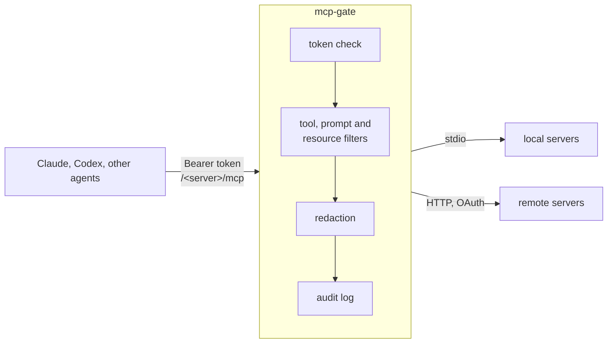

# mcp-gate

[](https://github.com/vsem-azamat/mcp-gate/actions/workflows/ci.yml)
[](https://github.com/vsem-azamat/mcp-gate/releases)
[](go.mod)
[](LICENSE)

A gateway for [Model Context Protocol](https://modelcontextprotocol.io) servers. Run your MCP servers behind one HTTP listener: each gets its own endpoint, each client its own named token, and every result passes through secret redaction before it leaves the host.

mcp-gate is a single static binary built on the official [MCP Go SDK](https://github.com/modelcontextprotocol/go-sdk).



## Features

- **One endpoint per server.** stdio and Streamable HTTP servers are served at `/<server>/mcp`. Children are supervised, probed and restarted with backoff. A server that is restarting keeps its catalog, so clients can still list its tools.
- **Named tokens.** Every token has a name, and the audit log shows which client made each call. Tokens can be global or limited to one server, and a server can be public.
- **Filters.** Allow or deny lists for tools, prompts and resources, per server.
- **Redaction that fails closed.** API keys, PEM keys, `Authorization` headers, `.env` lines, URL passwords and similar secrets are replaced with `[REDACTED:<kind>]` in tool, prompt and resource results, in errors and in child stderr. If a result cannot be redacted, the client gets an error instead. Optional rules cover Russian labels and high-entropy strings.
- **Escrow (optional).** Set an owner key and redacted secrets are kept in memory for a limited time. The owner can then fetch them over a small HTTP API with that key; client tokens cannot. Files that a tool downloads are scanned too, and held back if they contain secrets.
- **OAuth for remote servers.** `mcp-gate auth login` runs discovery, dynamic client registration and PKCE. Grants are stored on disk and refreshed automatically.
- **Protocol negotiation.** The gate learns which protocol version each server speaks, and keeps it across restarts. A version can also be pinned in the config.
- **Operations.** Health and readiness endpoints, a per-server `/_status` for admins, JSON logs with one audit line per call (arguments and results are never logged), and systemd units with sandboxing.
- **Migration tools.** `import` converts an [mcp-proxy](https://github.com/TBXark/mcp-proxy) config, and `compare` diffs the catalogs of two gateways or snapshots.

## Quick start

Download an archive for Linux or macOS (amd64 or arm64) from [Releases](https://github.com/vsem-azamat/mcp-gate/releases) and check it against `checksums.txt`. You can also build from source with Go 1.27 or newer:

```sh
go install github.com/vsem-azamat/mcp-gate/cmd/mcp-gate@latest
```

Write `gate.yaml`:

```yaml
version: 1
listen:
  addr: 127.0.0.1:9090
auth:
  tokens:
    laptop: "${GATE_TOKEN_LAPTOP}"   # the name shows up in the audit log
servers:
  files:
    stdio:
      command: npx
      args: [-y, "@modelcontextprotocol/server-filesystem", /srv/shared]
    tools: {deny: [write_file, move_file]}
  docs:
    http:
      url: https://docs.example.com/mcp
      oauth: {}                      # run `mcp-gate auth login gate.yaml docs` once
```

Check the config, then run the gate:

```sh
export GATE_TOKEN_LAPTOP=$(openssl rand -hex 32)
mcp-gate check -connect gate.yaml
mcp-gate serve gate.yaml
```

Point a client at a server's endpoint:

```json
{
  "mcpServers": {
    "files": {
      "type": "http",
      "url": "http://127.0.0.1:9090/files/mcp",
      "headers": {"Authorization": "Bearer <GATE_TOKEN_LAPTOP>"}
    }
  }
}
```

The [configuration reference](docs/configuration/README.md) lists every key. To run the gate as a service, see [systemd](docs/operations/systemd.md).

## Commands

| Command | What it does |
| --- | --- |
| [`serve`](docs/commands/serve.md) | Run the gateway |
| [`check`](docs/commands/check.md) | Validate a config; with `-connect`, also start every server once and report what it serves |
| [`auth`](docs/commands/auth.md) | `login`, `status` and `logout` for OAuth servers |
| [`compare`](docs/commands/compare.md) | Diff the tools, prompts and resources of two endpoints or snapshots |
| [`import`](docs/commands/import.md) | Convert an mcp-proxy `config.json` |

## Documentation

| | |
| --- | --- |
| [Configuration](docs/configuration/README.md) | Every key, its default and its meaning |
| [Commands](docs/commands/README.md) | How to use each subcommand |
| [Operations](docs/operations/README.md) | systemd units, running behind a reverse proxy, switching from mcp-proxy |
| [Architecture](docs/architecture/README.md) | How serving, downstreams, redaction, escrow and OAuth are built |
| [Specifications](openspec/specs/) | The exact behaviour, as requirements and scenarios |
| [Development](docs/development/README.md) | Setup, checks, tests and releases |

## Status

mcp-gate is young (v0.1) but already handles day-to-day traffic for a dozen servers. The config format is versioned (`version: 1`), and a key the build does not know is rejected rather than ignored. There is no config reload yet: after a change, restart the gate.

## License

[Apache-2.0](LICENSE)
